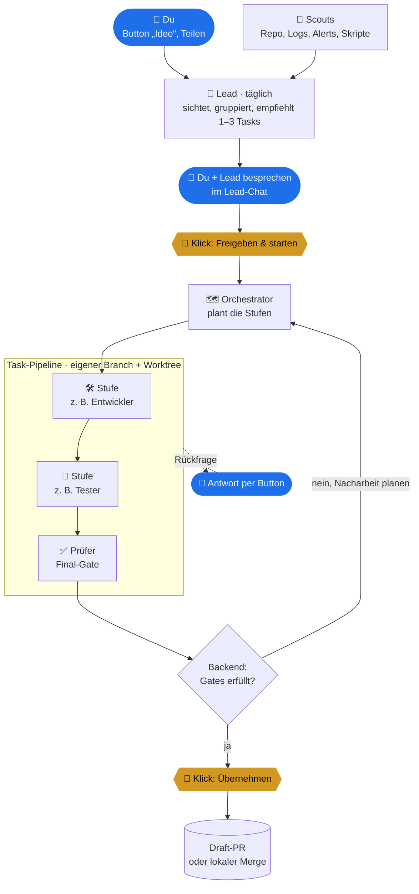
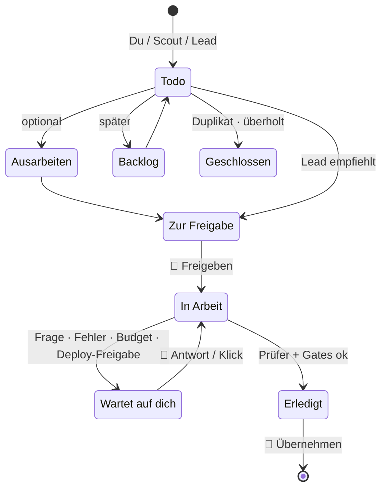
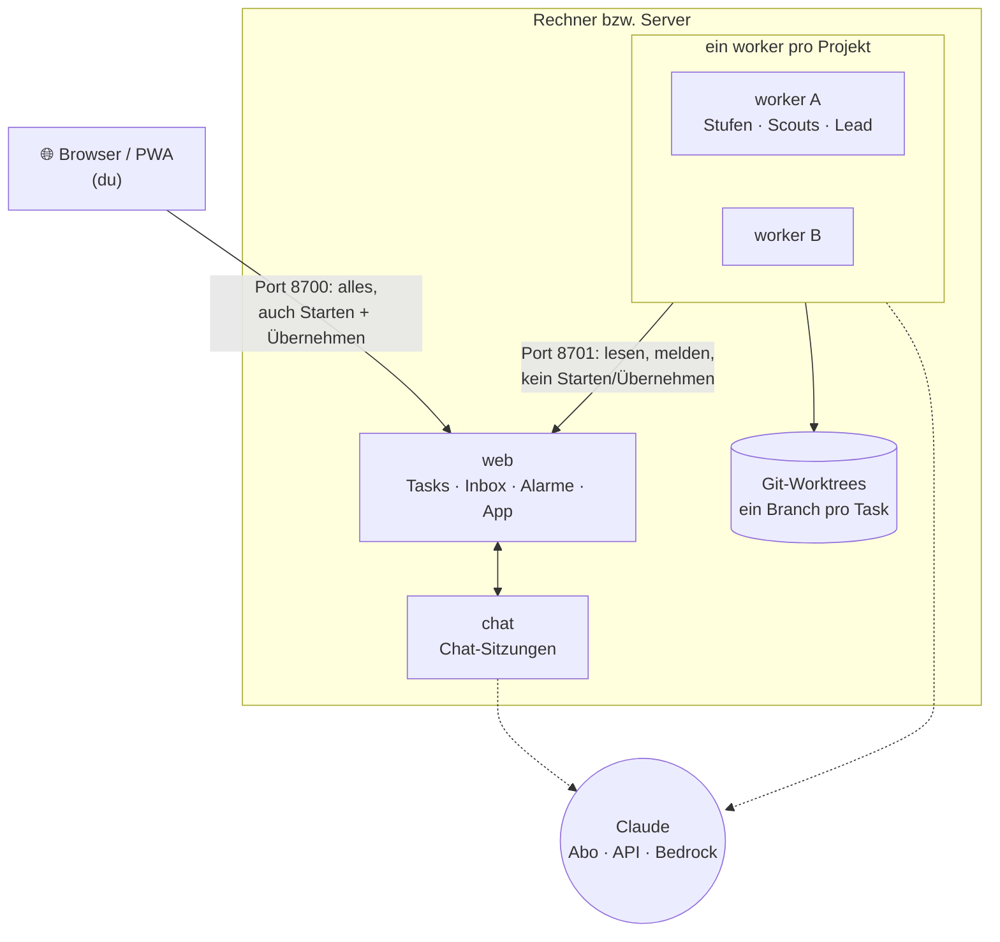

# agent-team

**Ein Team aus KI-Agenten pro Git-Projekt, mit einer Web-App, in der du
entscheidest.**

Für jedes Projekt (ein Repo oder eine Gruppe von Repos) legst du ein Team
aus Rollen fest:
- Software: z. B. Entwickler, Tester, Security, Reviewer
- Texte: z. B. Autorin, Faktenprüfer, Lektorin
- Daten: z. B. Analyst, Methodenprüfer

Das Team sammelt selbst Ideen, schlägt dir die wichtigsten vor und setzt
um, was du freigibst. Jede Arbeit läuft auf einem eigenen Branch.
Übernommen wird nur per Klick, als Draft-PR oder lokaler Merge.

- **Du entscheidest:** Starten, Übernehmen, Deployen und Veröffentlichen
  sind immer ein Klick von dir. Kein Agent kann das selbst auslösen.
- **Das Backend prüft, nicht die Agenten:** Ein Task ist erst fertig,
  wenn der Prüfer am Ende bestanden hat und alle Gates erfüllt sind.
  Ein Agent kann sich nicht selbst für erledigt erklären.
- **Für jedes Thema:** Rollen, Regeln und Scouts sind Dateien (YAML +
  Markdown), kein Code.
- **Läuft lokal oder auf einem Server.** Basis ist Claude Code bzw. das
  Claude Agent SDK. Zugang per Claude-Abo, API-Key oder Amazon Bedrock.

---

## Schnellstart: Claude richtet es ein

Repo klonen, darin [Claude Code](https://claude.com/claude-code) starten
und diesen Prompt einfügen:

```text
Richte agent-team auf diesem Rechner ein. Lies zuerst CLAUDE.md und
docs/SETUP.md und folge der Anleitung Schritt für Schritt. Stell mir die
Fragen aus „Den Nutzer fragen“, bevor du etwas konfigurierst, und rate
nichts. Ändere keinen Code im Repo; meine Konfiguration und Teams gehören
nach ~/.agent-team/. Für Projekte, die keine Webanwendung sind, entwirf das
Team mit mir zusammen nach docs/TEAMS.md. Am Ende: tools/run-local.sh --check
grün, App starten und den Smoke-Test aus der Anleitung mit mir durchgehen.
```

Claude fragt dich zuerst:
- Projekte und Thema
- Zugang zu Claude
- wie übernommen wird (Draft-PR oder lokaler Merge)
- Budget
- was Agenten nie anfassen dürfen

Danach legt es die Konfiguration unter `~/.agent-team/` an. Von Hand geht
es mit derselben Anleitung: **[docs/SETUP.md](docs/SETUP.md)**.

---

## Wer macht was



<sub>Blau: du. Gelb: Klicks, die nur du auslösen kannst. Alles andere:
Agenten und Backend.</sub>

**Ablauf im Detail:**

1. **Ideen** kommen von dir oder von **Scouts**. Ein Scout ist ein
   periodischer Agenten-Lauf mit klarem Auftrag, z. B.:
   - neue Dependabot-Alerts zusammenfassen
   - neue Fehler in den Logs gruppieren
   - Verbesserungen im Repo vorschlagen

   Daten holt bei Bedarf vorher ein Skript ohne KI ab (`prepare`).
2. Der **Lead** läuft täglich:
   - Er prüft, ob die Ideen noch aktuell sind, und fasst Doppeltes
     zusammen.
   - Veraltetes parkt oder schließt er, jeweils mit Begründung.
   - Er empfiehlt die nächsten Tasks, die ins Budget passen.
   - Er sieht sich Alarme (Watchdog) an und legt bei echten Problemen
     Fix-Tasks an.
   - Er schreibt Folge-Tasks aus erledigter Arbeit.
3. Du **besprichst** die Empfehlung im Lead-Chat und **gibst frei**. Ab dann
   hat der Task einen eigenen Chat, in dem jede Stufe lesbar mitläuft.
4. Der **Orchestrator** plant die Stufen. Jede Stufe ist eine Rolle mit
   eigenem Prompt:
   - `implement`-Rollen dürfen Dateien ändern. Nach jeder solchen Stufe
     wird committet.
   - `advise`-Rollen lesen nur und urteilen.
5. Das **Backend** wertet jedes Stufen-Ergebnis aus, ein JSON-Block mit
   `pass`, `fail`, `needs_input` oder `blocked`. Bei `fail` plant der
   Orchestrator Nacharbeit (begrenzte Runden).
6. Am Ende steht der **Prüfer**. Besteht er und sind alle Gates erfüllt,
   ist der Task fertig. Du schaust dir den Diff an und klickst
   **Übernehmen**.

**Gates**, alle in `team.yaml` einstellbar und vom Backend erzwungen:

| Gate | Wirkung |
|---|---|
| `final` + `gate_roles` | Der Plan endet immer mit dem Prüfer. Fertig ist der Task erst, wenn er besteht. |
| `follow_up` | Auf Rolle X folgt immer Prüfer Y, z. B. Backtest → Audit. |
| `metric_gates` / `metric_files` | Kennzahlen müssen Schwellen erreichen, wahlweise aus Rohdateien nachgerechnet. |
| `confirm_roles` | Die Stufe (Deploy, Veröffentlichen …) startet nur per Klick. |
| `wait_roles` | Mindestwartezeit vor einer Stufe, z. B. 14 Tage Beobachtung. |
| wiederholte Findings | Nennt dieselbe Rolle dasselbe offene Problem zweimal, wird der Task gestoppt. |

---

## Ein Task, von der Idee bis zum Ende



Jeder Zustand zeigt in der App, **wer dran ist**. Details zum Ablauf stehen
in [docs/TASKS-V2.md](docs/TASKS-V2.md).

---

## Was sonst dazugehört

- **Chats:** freie Chats pro Projekt, ein Lead-Chat und ein Chat pro Task.
  Rückfragen kommen als Karte mit Antwort-Buttons.
- **Alarme:** Programme und Watchdogs melden sich per HTTP in der App, nicht
  per Mail oder Messenger. Der Lead sieht sie sich an.
- **Budget:** Die autonome Arbeit von Scouts und Lead ist gedrosselt:
  - beim Claude-Abo das Wochenlimit gleichmäßig über die Tage verteilt
  - sonst eine Dollar-Grenze pro Tag und Woche

  Deine eigenen Klicks laufen immer.
- **Wochenbericht** pro Team, montags im Lead-Chat.
- **Gedächtnis:** Projektwissen und Entscheidungen werden pro Projekt
  festgehalten und in spätere Läufe mitgegeben.

---

## Aufbau



- **web** hält Tasks, Inbox und Alarme und liefert die App aus. Browser und
  Agenten kommen über getrennte Ports bzw. Netze. Was nur du darfst, nimmt
  die Web-App ausschließlich vom Browser an.
- **worker**, einer pro Projekt, führt die Stufen, Scouts und den Lead
  aus. Gearbeitet wird in Worktrees unter `agent/<nr>` bzw. `task/<nr>`,
  nie in deinem Checkout.
- **chat** führt die Chat-Sitzungen aus. Sie bleiben in ihrem eigenen
  Projekt (Scope-Prüfung).

---

## Betrieb

| | **Lokal** (empfohlen zum Start) | **Server / Docker** |
|---|---|---|
| Start | `tools/run-local.sh` | `docker compose up -d` |
| Erreichbar | nur `http://127.0.0.1:8700` | z. B. hinter Cloudflare Access, als PWA mit Push aufs Handy |
| Konfiguration | `~/.agent-team/` (außerhalb des Repos) | eigene Compose-Datei + `projects.yaml` (außerhalb des Repos) |
| Anleitung | [docs/SETUP.md](docs/SETUP.md) | [docs/DOCKER.md](docs/DOCKER.md) |

## Ein eigenes Team

Zwei Vorlagen liegen bei:
- [`templates/team-basic`](templates/team-basic): Bearbeiter, Prüfer, Lead,
  Orchestrator. Startpunkt für jedes Thema.
- [`templates/team-webapp`](templates/team-webapp): Software mit Build,
  Tests, Security-Rolle, Dependabot- und Log-Scout.

Wie man daraus ein Team für ein beliebiges Thema macht (Rollen, Gates,
Scouts, alle Einstellungen), steht in **[docs/TEAMS.md](docs/TEAMS.md)**.

## Sicherheit

| Schutz | Wie |
|---|---|
| Nur du startest, übernimmst und deployst | Diese Aktionen nimmt die Web-App nur vom Browser-Port bzw. hinter Access an. Agenten bekommen `403`. |
| Dein Checkout bleibt unberührt | Jeder Task arbeitet in einem eigenen Worktree. Übernommen wird nur per Klick. |
| Keine Secrets in Commits | `.env`, Schlüssel und Tokens werden nie committet. |
| Keine versehentlichen Deploys | `deploy_guard`: Ein Hook auf jeden Tool-Aufruf verweigert Schreiben auf Deploy-Pfade, Deploy-Profile und -Befehle. |
| Chats bleiben im Projekt | Eine Scope-Prüfung blockt Zugriffe auf die Ordner anderer Projekte. |

> **Keine Sandbox.** Agenten laufen mit den Rechten des Benutzers, unter dem
> agent-team läuft, wie Claude Code mit `bypassPermissions`. Die Sperren
> fangen Versehen ab, keine Absicht. Wer mehr Trennung will, startet
> agent-team unter einem eigenen Benutzer oder in Containern.

## Repo

```
src/agent_team/        Backend
  app.py               Web-API, Rechte (Browser- vs. Agenten-Port)
  tasks/               Task-Datenbank, Zustände, Gates, Rollenkatalog
  worker/              Stufen, Worktrees, Scouts, Lead, Wochenbericht
  chat/                Chat-Dienst (Claude Agent SDK)
  local.py             nativer Start aller Prozesse (ohne Docker)
  guard.py             Deploy-Sperre
  budget.py            Budget-Pacing (Abo oder USD)
frontend/              React-PWA
base/                  gemeinsame Helfer (Tasks-API-Client, Modellkatalog)
templates/             Team-Vorlagen
config/                Beispiel-Konfiguration (*.example.yaml)
docs/                  SETUP · DOCKER · TEAMS · TASKS-V2
tests/                 pytest
```

**Tests:**
```bash
.venv/bin/pip install -r requirements-dev.txt
PYTHONPATH=src:base .venv/bin/python -m pytest tests
```
Die Tests bringen eigene Beispiel-Teams mit (`tests/fixtures/`) und
brauchen nichts außerhalb des Repos.
